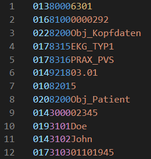
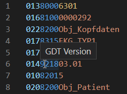
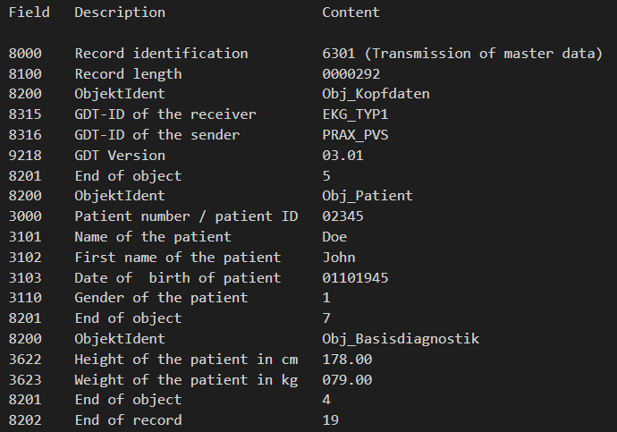

# GDT Language Support (**G**eräte-**D**aten-**T**räger)

Visual Studio Code extension for GDT files – and for the related xDT formats **LDT** and **KVDT**.  
Download from [Visual Studio Marketplace][1], [Open VSX][2] or [GitHub][3].

## Features
### Supported formats

| Language | File extensions | Descriptions based on |
|---|---|---|
| GDT | `.gdt` | GDT 2.1 – 3.5 (QMS e.V.); GDT 3.5 fields taken from the LDT field table, as required by the GDT 3.5 specification |
| LDT | `.ldt` | KBV, LDT 3 Satzbeschreibung 3.2.20 |
| KVDT | `.con` | KBV, Datensatzbeschreibung KVDT 6.09 (container and ADT records) |

LDT and KVDT files with other extensions are detected by their first line (`8000` with `8220`/`8230` resp. `con0`).
LDT and KVDT descriptions are only available in German (there are no official English terms); they are shown regardless of the selected language.

xDT files use ISO 8859-15 and CR LF. The extension therefore sets `files.encoding` to `iso885915`, `files.eol` to `\r\n`
and disables `files.trimTrailingWhitespace` for all three languages. This can be changed in the settings, e.g.
`"[gdt]": { "files.encoding": "cp437" }` for old GDT 2.x devices.

### Syntax highlighting

Different colors for GDT segments:  

  

**Change colors and font styles:**  
Press `F1` and select `Preferences: Open Settings (Json)`.  
Add `"editor.tokenColorCustomizations"` with `"textMateRules"` and your desired colors and font styles for the different scopes.
([Official Documentation](https://code.visualstudio.com/docs/getstarted/themes#_editor-syntax-highlighting))

Available scopes (`.gdt`, `.ldt` or `.kvdt`):
- Length of line: `variable.gdt`
- Field identifier (default): `keyword.gdt`
- Field identifier (patient): `keyword.control.gdt`
- Record type: `constant.character.escape.gdt`
- Data content (default): `string.gdt`
- Data content (comment): `comment.gdt`

Example: 
```json
{
    "editor.tokenColorCustomizations": {
        "textMateRules": [
            {
                "scope": "variable.gdt",
                "settings": {
                    "foreground": "#4d4d4d"
                }
            },
            {
                "scope": "string.gdt",
                "settings": {
                    "fontStyle": "bold"
                }
            }
        ]
    }
}
```
### Field identifiers and record types
**Select language and add custom descriptions or overwrite existing ones:**   
File -> Preferences -> Settings -> Extensions -> GDT  

**Tooltip descriptions**  
English and german tooltip descriptions for field identifiers and record types:  

  

The descriptions should load and update automatically for GDT files but you can also run the command manually.  

**Display message**  
Show messsage with fields and descriptions in output channel:

  

### Fix length of line
A command to change the length of line variables (first three digits) to the actual line length **(including whitespaces) + 2** (*CR LF*).

[1]: https://marketplace.visualstudio.com/items?itemName=Lixfeld.gdt
[2]: https://open-vsx.org/extension/Lixfeld/gdt
[3]: https://github.com/Lixfeld/VSCode-GDT-Extension/releases
